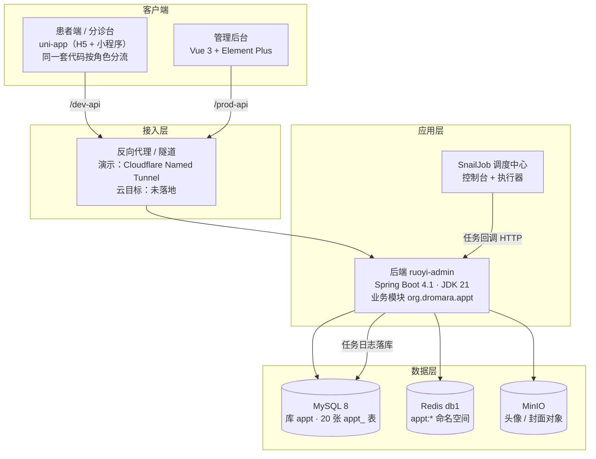
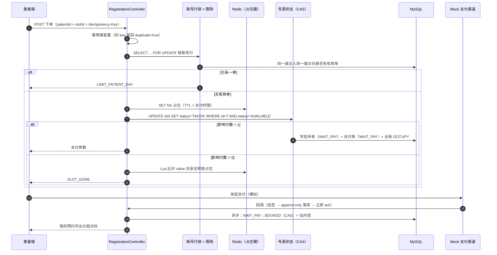
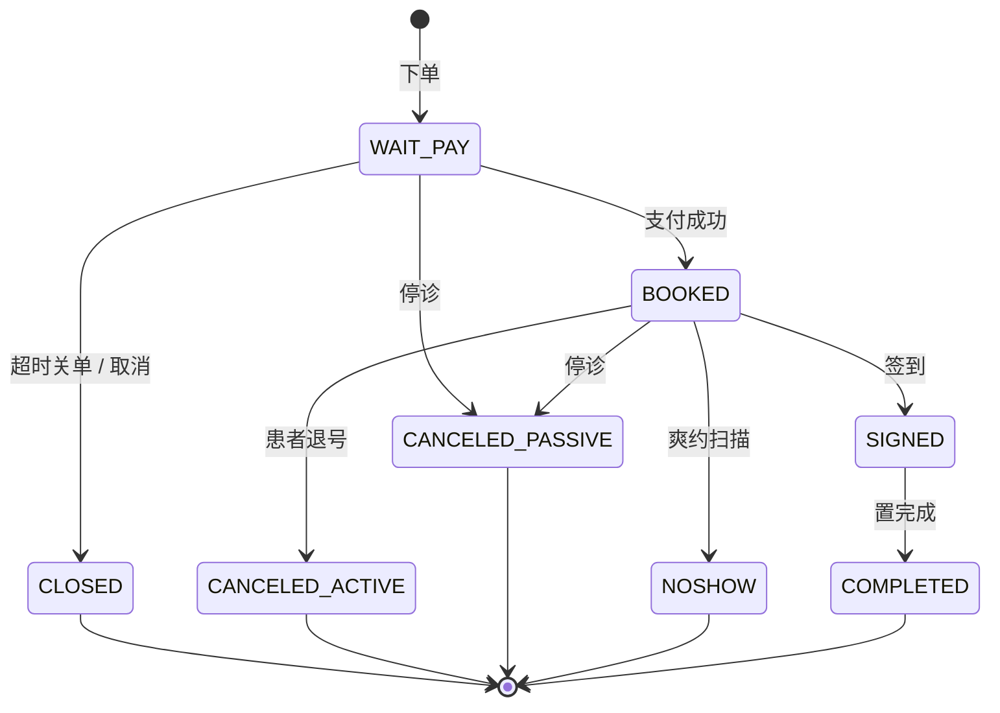

# 系统架构（ARCHITECTURE）

> 本文只描述**当前代码里真实存在**的结构与调用关系。业务规则权威在 `qd-appt-docs` 的 `PRD.md`，
> 接口形态权威在 `api-contract.md`，字段级设计权威在 `database-design.md`。本文与它们冲突时以上游文档为准。
>
> 形态：**模块化单体**（一个后端进程 + 一个库），不使用微服务、不使用消息队列、不使用全文检索引擎。

---

## 1. 组件与部署视图

- **一个后端镜像**包含 Web 服务与业务模块，`ruoyi-modules/appt` 是全部自研业务代码；框架（鉴权 / 租户 / OSS / 代码生成）来自 RuoYi-Vue-Plus 上游基线。
- **Redis 只承担三件事**：午别余量缓存、下单占位键、分布式锁（放号 / 对账等任务）。业务数据不在 Redis 里持久化。
- **SnailJob** 负责放号、超时关单巡检、爽约扫描、置完成、日终对账；每次执行都写 `appt_job_log`，判据是「受影响行数」而不是调度器显示的「成功」。
- **MinIO** 只存头像与封面；接口返回 ossId，前端用 `*Url` 字段兜底展示。

## 2. 四层 API 边界

接口按**调用者**分层，不按资源分层；四层不混用，服务端强制校验（前端判断不作为安全边界）。

| 层 | 路径前缀 | 鉴权 | 典型调用方 | 代表端点 |
|---|---|---|---|---|
| 公开查询 | `/appt/public/**` | 匿名（白名单） | 患者端未登录页 | 院区列表、科室树、医生分页与主页、可约时间点、余量 |
| 患者 | `/appt/patient/**` | 登录（患者身份） | 患者端 | 下单、支付、我的预约、退号、就诊人、收藏、消息、签到码 |
| 分诊 | `/appt/triage/**` | 登录 + `triage` 角色 | 分诊台 | 扫码签到、手动补签、当日签到列表、停诊上报 |
| 管理 | `/appt/admin/**` | 登录 + 按钮权限 | 管理后台 | 基础数据维护、排班生成、号源台账、挂号单、支付与退款、停诊处理、黑名单、对账、看板 |

约束：
- 分诊端请求**不传院区 id**，数据范围由服务端按账号解析；患者端全部按登录人过滤，不接受前端传入的 `userId`。
- 金额与 19 位雪花 id 一律以**字符串**序列化；前端不得 `Number()` 转换。
- 公开层只读；写操作一律落在患者 / 分诊 / 管理层。

## 3. 预约主链路（下单到支付完成）

关键点：
- **三道防线的职责不同**：Redis 占位挡掉绝大多数并发（可用配置关闭，属可降级项）；DB 条件更新保证单行状态只前进一步；唯一索引 `UNIQUE(slot_id, active_flag)` 兜住「有效单」唯一性。三者不是「三层都保证绝对正确」。
- **限购按账号串行化**：同一账号的并发下单先锁 `sys_user` 单行，再在锁内精查，避免两条并发各自看到「没有有效单」。
- **失败即回滚占位**：占位值由 Lua 比对后释放，避免误删别人的键。
- **回调先落库再入账**：回调记录 append-only，重复回调只做去重不做二次入账；关单后到达的回调自动转退款分支。

## 4. 数据模型（20 张业务表，按域分组）

| 域 | 表 | 说明 |
|---|---|---|
| 基础资料（6） | `appt_campus` · `appt_clinic_type` · `appt_department` · `appt_medical_staff` · `appt_fee_standard` · `appt_slot_template` | 院区、门诊类型、科室树、医务人员、收费标准、时段模板 |
| 排班与号源（4） | `appt_schedule` · `appt_slot` · `appt_slot_ledger` · `appt_suspend_record` | 排班、号源、号源台账、停诊记录 |
| 交易（4） | `appt_registration` · `appt_payment` · `appt_refund` · `appt_payment_callback` | 挂号单、支付单、退款单、支付回调（append-only） |
| 患者与治理（4） | `appt_patient` · `appt_staff_favorite` · `appt_blacklist` · `appt_notice` | 就诊人、收藏、黑名单、站内信 |
| 运维（2） | `appt_job_log` · `appt_reconcile_result` | 任务日志、对账结果 |

设计约定（与实现一致）：
- **不设 `del_flag`**：需要「失效但保留」的语义用 `status` 或 `active_flag`；基础数据删除前做引用校验，被引用则拒绝并提示先停用。
- **号源不物理删除**：`slot.status` 表达 `AVAILABLE / TAKEN / SUSPENDED / EXPIRED`，历史通过台账追溯。
- **挂号单有效性**：`active_flag = 1` 表示有效行，进入终态时置 `NULL`，配合唯一索引实现「同一号源只能有一张有效单」。
- **金额快照**：挂号单保存下单时的金额，后续调价不影响历史单。
- **PII**：证件号可明文展示于演示数据，代码预留加密接口位（`IdNoEncryptor`），日志不打印证件号。

## 5. 状态机

**挂号单（8 态）**

**支付单（4 态）**：`WAIT_PAY → PAID → REFUNDED`；`WAIT_PAY → CLOSED`。
**号源（4 态）**：`AVAILABLE → TAKEN`、`AVAILABLE → SUSPENDED`、`AVAILABLE → EXPIRED`、`TAKEN → EXPIRED`（终态流转释放占号）。
**结算（3 态，挂在挂号单上）**：`NONE → WAIT_REFUND → REFUNDED`。

所有状态推进都是**条件更新**（`WHERE status = 旧值`），影响行数 0 即视为并发失败，不做「先查后改」。

## 6. 部署拓扑（三种形态，只有前两种有实测）

| 形态 | 组成 | 状态 |
|---|---|---|
| 开发态 | 本机 JDK 21 + Node + 已存在的 MySQL / Redis；端口 `8082 / 8083 / 8084` | 日常使用 |
| 演示 / 部署态 | Docker Compose 五件套：应用四件（api / snailjob / admin / h5）+ 依赖三件（MySQL / Redis / MinIO）；端口 `18082 / 18083 / 18084` | 已在 WSL2 实跑；Cloudflare Named Tunnel 按需开启 |
| 云目标 | 服务器 + 域名 + HTTPS + 反代 + 小程序合法域名 | **未开始（S16.2，阻塞于服务器）**；仓库里只保留 `compose.cloud.yml` 结构 |

发布链：镜像推 GHCR → 部署机只 clone 门面仓 → `deploy.sh up --tag <不可变 tag>` → 探活 → 写 `.state/current`；回滚是把 `.state/previous` 的 tag 重新拉起。**部署链永不带 `compose.build.yml`**。

## 7. 架构决策索引（ADR）

| 编号 | 决策 | 结论 |
|---|---|---|
| [ADR-0001](https://github.com/xcqj/qd-appt-docs/blob/main/adr/ADR-0001-purchase-limit-scope.md) | 限购口径 | 同一就诊人同一就诊日 1 单，跨院区共享；旧口径（同医生同日 / 最多 3 单）废弃 |
| [ADR-0002](https://github.com/xcqj/qd-appt-docs/blob/main/adr/ADR-0002-suspend-two-phase-and-batch-idempotency.md) | 停诊两段式与批号幂等 | 登记不动号源、处理才回池退款；一条登记一个批号，重复提交不放大影响面 |
| [ADR-0003](https://github.com/xcqj/qd-appt-docs/blob/main/adr/ADR-0003-active-flag-and-unique-index.md) | `active_flag` 与唯一索引 | 号源不物理删除，唯一索引只约束有效行；终态置 `NULL` 释放额度 |
| [ADR-0004](https://github.com/xcqj/qd-appt-docs/blob/main/adr/ADR-0004-scope-value-composite-key.md) | 停诊范围复合键 | `scope_type + scope_value` 由统一构造器生成（曾两次串号） |
| [ADR-0005](https://github.com/xcqj/qd-appt-docs/blob/main/adr/ADR-0005-time-point-format.md) | 时刻口径 | 后端统一以 `HH:mm` 序列化，前端不再二次截断 |
| [ADR-0006](https://github.com/xcqj/qd-appt-docs/blob/main/adr/ADR-0006-three-layer-defense.md) | 三层防线 | Redis 预扣 → DB 单柱 CAS → 应用重试；摘任一层都有对照实验 |

## 8. 没有做的事（避免误读）

- 没有微服务拆分、没有 MQ、没有 ES；搜索用 `LIKE`。
- 没有多租户（框架默认关闭，业务不做租户隔离）。
- 没有真实支付渠道、没有医保、没有问诊开方；小程序未做公网域名验收。
- 没有版本化数据库迁移工具，DDL 靠「先加后删」的发布纪律。
