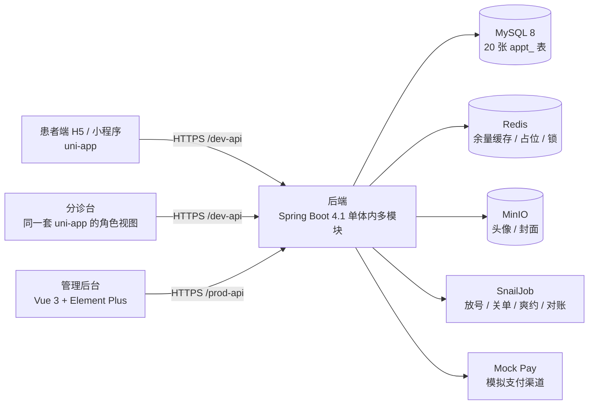
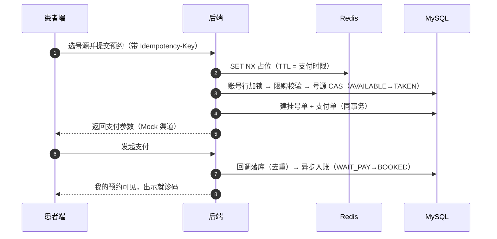

# 号源 QueueDepth · 医院门诊预约挂号系统

> 一套可跑通、可讲解、可复现的**全栈预约挂号演示系统**：患者端完成「选院区 → 科室 → 医生 → 号源 → 支付 → 就诊码」，
> 分诊台做扫码签到与停诊上报，管理端做排班放号、运营看板与对账。
>
> **技术演示项目：全部数据虚构，不使用任何真实医院 / 科室 / 医务人员信息；支付走模拟渠道；不提供任何真实医疗服务，不问诊、不开方。**

本仓是**项目总览仓**，不承载业务代码，只提供仓库导航、架构说明、演示入口与技术资料。业务代码在五个独立仓中。

---

## 目录

- [这个项目解决什么问题](#这个项目解决什么问题)
- [在线演示](#在线演示)
- [源代码仓库](#源代码仓库)
- [系统架构](#系统架构)
- [核心业务流程](#核心业务流程)
- [技术栈](#技术栈)
- [技术亮点](#技术亮点)
- [测试与验证](#测试与验证)
- [部署与演示环境](#部署与演示环境)
- [项目状态与已知限制](#项目状态与已知限制)
- [安全审计](#安全审计)
- [文档导航](#文档导航)
- [License](#license)

---

## 这个项目解决什么问题

门诊号源是典型的**不可储存资源**：当天没用掉的号，价值永久归零。医院要在有限的医生出诊时间里把号公平地分出去，同时压住三件事——**同一号源被两个人抢到（超卖）**、**黄牛批量占号**、**患者爽约造成的空转**。

系统面向三类角色，覆盖一条完整链路：

| 角色 | 能做什么 |
|---|---|
| 患者（移动端 H5 / 小程序） | 选院区 → 科室 → 医生 → 排班 → 时间点 → 确认 → 支付 → 就诊码；退号、就诊人管理、收藏医生、站内信 |
| 分诊台（移动端，同一套代码的角色视图） | 扫码签到 / 手动补签、当日签到列表、停诊上报（按排班 / 医生某日 / 院区某日） |
| 医院运营（管理后台） | 院区 / 科室 / 人员 / 时段模板 / 收费标准维护、排班生成与放号、挂号单与支付单、停诊处理、黑名单与限购、号源台账、七查对账、运营看板 |

**范围**：单医院 + 3 个院区；普通 / 夜间延时 / 知名专家三类门诊；挂号及其支付、履约（签到）、售后（退号退款、停诊）。
**明确不做**：医保、真实支付渠道签约、候补队列、改约、在线问诊与开方、检查治疗预约、报告 / 账单 / 评价、多医院租户化、全文检索（PRD §1.4）。

## 在线演示

| 应用端 | 演示地址 | 主要用途 | 访问说明 | 当前状态 |
|---|---|---|---|---|
| 患者端 H5 | <https://demo.qdappt.us.ci/> | 选院区 → 挂号 → 支付 → 就诊码；退号、就诊人、收藏、消息 | 手机或桌面浏览器；登录角色由账号决定 | **按需开启**（2026-11-11 实测 502，当前未在线） |
| 分诊台 | <https://demo.qdappt.us.ci/> | 扫码签到 / 手动补签、当日签到列表、停诊上报 | **与患者端同一入口**，按登录账号的角色进入不同底栏 | 同上 |
| 管理后台 | <https://admin.qdappt.us.ci/> | 排班放号、挂号单与支付单、停诊处理、对账、运营看板 | 桌面浏览器 | 同上（2026-11-11 实测 502） |

**关于可用性（如实说明）**

- 演示环境是**本机 WSL2 + Docker Compose + Cloudflare Named Tunnel**，不是云服务器、不是生产环境、不是高可用架构。
- 按需开启：宿主机休眠 / 关机 / 网络中断 / 维护期间不可访问，**不承诺 SLA、不承诺持续在线**；需要体验时请联系维护者开启隧道。
- **演示账号不使用公开口令**：账号由维护者通过私下渠道单独提供，按角色最小权限分配，仅用于体验演示数据；管理员口令不随仓库公开。
- 演示库内全部为虚构数据；支付为 Mock 渠道，不产生真实资金流；请勿写入任何真实个人信息。

**本地一键起（不依赖在线演示）**

```bash
# 前置：只装 Docker（含 compose ≥ 2.20）；五个仓同级 clone 到同一目录
mkdir -p qd-appt && cd qd-appt
for r in backend admin app docs showcase; do git clone git@github.com:xcqj/qd-appt-$r.git; done
cd showcase && ./demo.sh
```

就绪后本地入口（演示态固定 `18xxx`，与开发态 `8xxx` 永不重叠）：

| 入口 | 地址 |
|---|---|
| 患者端 H5 / 分诊台 | `http://localhost:18084` |
| 管理后台 | `http://localhost:18083` |
| 后端 OpenAPI JSON | `http://localhost:18082/v3/api-docs` |
| 任务调度控制台 | `http://localhost:18800/snail-job` |

脚本共 8 步：检查 Docker 与端口 → 拉取或本地构建四个镜像 → 起 MySQL / Redis / MinIO → 建库导入演示数据 → 建 MinIO bucket → 起后端 / 后台 / H5 → 逐端探活 → 汇总打印入口。首次约 2–8 分钟（视镜像缓存），复跑约 1 分钟。子命令：`./demo.sh down` / `reset` / `logs`。

## 源代码仓库

| 仓库 | 职责 | 主要技术栈 | 可见性 |
|---|---|---|---|
| [`qd-appt-backend`](https://github.com/xcqj/qd-appt-backend) | 后端服务：20 张业务表、四层 API、号源占位与状态机、Mock 支付、对账、定时任务 | Java 21 · Spring Boot 4.1 · MyBatis-Plus · Sa-Token · Redisson · MySQL 8 · Redis · MinIO · SnailJob | Public |
| [`qd-appt-admin`](https://github.com/xcqj/qd-appt-admin) | 管理后台：业务表维护、排班生成、停诊处理、号源台账、对账与运营看板 | Vue 3 · TypeScript · Element Plus · Vite · pnpm | Public |
| [`qd-appt-app`](https://github.com/xcqj/qd-appt-app) | 移动端：患者端 + 分诊台双角色，一套代码出 H5 与微信小程序 | uni-app (Vue 3 + TS) · Wot UI | Public |
| [`qd-appt-docs`](https://github.com/xcqj/qd-appt-docs) | 文档单一权威：PRD、技术方案、API 契约、库表设计、ADRs、测试证据、排期 | Markdown · Python（文档门禁） | Public |
| [`qd-appt-showcase`](https://github.com/xcqj/qd-appt-showcase) | 门面与物料：截图与录制脚本、一键演示 `demo.sh`、部署五件套与发布脚本 | Playwright · Docker Compose · Bash | Public |

> 仓库可见性以 GitHub 实际状态为准。本总览仓先行公开；若某个链接暂时打不开，表示该仓库的可见性尚未切换，不是死链。
> 五个业务仓各自独立提交，总览仓不镜像、不复制任何业务代码。

## 系统架构



- **模块化单体**：一个后端镜像、一个数据库，业务在 `org.dromara.appt` 模块内按领域分包；不使用微服务、MQ、ES。
- **四层 API 边界**（互不复用，服务端强校验）：`/appt/public/**` 匿名查询 · `/appt/patient/**` 登录患者 · `/appt/triage/**` 登录 + 分诊角色 · `/appt/admin/**` 登录 + 按钮权限。
- **主数据关系**：科室树全局统一定义，医务人员关联「院区 + 科室」；切换院区只展示该院区有出诊医生的科室。

组件图、四层边界细节、预约主链路时序图与 6 篇 ADR 索引见 **[ARCHITECTURE.md](ARCHITECTURE.md)**。

## 核心业务流程

**① 预约到支付（主链路）**



三道防线各司其职：Redis 占位挡掉大部分并发（可降级关闭）、数据库条件更新保证单行状态只前进一步、唯一索引兜住最后一道。**没有「绝对不超卖」的结论**——三者职责与实测边界见 [技术亮点](docs/technical-highlights.md)。

**② 停诊两段式**：分诊台登记只落「待处理」，**不动号源**；管理端处理时才回池、发站内信、对已支付单触发退款；一条登记一个批号，重复提交不放大影响面（ADR-0002）。

**③ 退号与爽约**：退号即时回池并可再次预约；爽约扫描每轮全量兜底，判为爽约的号源在终态流转时释放，避免「幽灵占号」。

## 技术栈

| 层次 | 选型 |
|---|---|
| 后端 | Java 21 · Spring Boot 4.1.0 · MyBatis-Plus 3.5.17 · Sa-Token 1.45.0 · Redisson 4.6.1 · SpringDoc 3.0.3 |
| 数据与中间件 | MySQL 8（`utf8mb4`）· Redis（余量缓存 / 占位键 / 分布式锁）· MinIO（对象存储） |
| 任务调度 | SnailJob 2.0.2（放号、超时关单、爽约扫描、日终对账，任务日志落库） |
| 管理后台 | Vue 3.5 · TypeScript 6 · Element Plus 2.14 · Vite 8 · pnpm |
| 移动端 | uni-app 3.0（Vue 3 + TS）· Wot UI 2.3 · 一套代码出 H5 与小程序 |
| 工程与部署 | Maven 多模块 · GitHub Actions（CI + 镜像）· GHCR · Docker Compose（五件套）· 自托管 Runner（WSL 目标） |

## 技术亮点

五个设计按「问题 / 方案 / 验证 / 边界」四段写在 **[docs/technical-highlights.md](docs/technical-highlights.md)**：

| 设计 | 一句话 |
|---|---|
| 三层防线 | Redis 占位 → DB 单柱 CAS → 唯一索引兜底；摘掉防线① 后仍 1 成交 / 49 被拒（对照实验，非并发一致性结论） |
| 限购口径 | 同一就诊人同一就诊日 1 单、跨院区共享；按账号行锁串行化后再统计，锁内精查给精确错误码 |
| 停诊两段式 | 登记不动号源、处理才回池退款；一条登记一个批号，重复提交不重不放 |
| 余量聚合与缓存 | 一屏一次分组聚合（不随医生数增长）；Redis 增量写有 Lua 守卫，无键不创建 |
| 支付回调幂等 | 回调 append-only 落库 + 去重键；3 次重复回调只入账 1 次，关单后回调自动转退款 |

历史决策全文见 `qd-appt-docs` 仓的 `adr/` 六篇（限购口径 / 停诊两段式 / `active_flag` 与唯一索引 / 停诊范围复合键 / 时刻口径 / 三层防线）。

## 测试与验证

以下全部是**本机单机环境**的实测记录，复现脚本在 `qd-appt-backend/script/test/`，原始输出在 `qd-appt-docs` 的 `test-evidence.md`。

| 验证项 | 方式 | 规模 | 结果 | 出处 |
|---|---|---|---|---|
| 排班生成幂等 | 单机脚本 + 任务控制台 | 80 排班 / 2820 号源 | 连跑两次：新增 0、跳过 2820 | 证据 §1 |
| 并发抢同一号源 | 单机脚本（50 并发） | 50 线程争 1 个号源 | 恰 1 笔成交、49 笔 `SLOT_GONE`；断言 `PASS=14` | 证据 §2 |
| 摘除 Redis 占位的对照 | 启动参数开关 A/B | 同上 | 仍 1 成交、49 由数据库 CAS 拒绝；占位键不存在 | 证据 §3 |
| 支付回调幂等 | 单机脚本 | 同一回调重复 3 次 | 入账 1 次、回调记录 1 条、2 次标记重复；`PASS=20` | 证据 §5 |
| 余量缓存读取 | 单机压测（curl 开销计入） | 100 并发 × 1000 样本 × 3 轮 | p95：缓存 9.3 ms / 直查 10.6 ms；QPS 1050 / 1160（默认仍用缓存） | 证据 §7 |
| 状态机闭环 | 单机脚本 | 退号 / 退款 / 签到 / 爽约 | `PASS=19`；爽约全量兜底把 −3h 陈旧单判为爽约 | 证据 §8 |
| 终态号源释放 + 对账 | 夹具 + 手工触发 | 七查 | 对账 907 ms、七查全 0、结果 0 行、幽灵占号不再新增 | 证据 §23 |
| 发布 / 回滚 | 手工实跑 + CI | 四枚镜像 | 发布 39 s、回滚 42 s、前滚 46 s、备份 1 s、恢复 62 s | 证据 §25 |

**口径与限制**：以上是**单机脚本 / 配置开关对照 / 手工验收**，不是生产压测，也不能外推为线上容量结论；缓存对比的差异只有 14%，文档结论是「默认保持缓存」，不是「缓存显著更快」；并发正确性的证据是「50 并发下恰好 1 笔成交」，不构成对任意并发度的证明。

## 部署与演示环境

| 形态 | 入口 | 说明 |
|---|---|---|
| 在线演示（按需开启） | `demo.qdappt.us.ci` / `admin.qdappt.us.ci` | WSL2 + Docker Compose + Cloudflare Named Tunnel；不承诺 SLA |
| 本地一键演示 | `showcase/demo.sh` | 空机器装 Docker 即可，8 步起全栈，演示态端口 `18082/18083/18084` |
| 镜像部署 | `showcase/deploy/deploy.sh` | 拉 GHCR 镜像起栈：`up / adopt / rollback / status / backup / restore / down / logs`，tag 不可变、可回滚 |
| 云服务器 | **未开始（S16.2）** | 服务器与备案未就绪，`cloud` 目标只保留结构，无公网 HTTPS 验收记录 |

已知工程边界（如实说明）：没有版本化数据库迁移工具（DDL 采用「先加后删」两阶段纪律）；演示与开发端口分离（`18xxx` / `8xxx`）但共用同一台机器；镜像 tag 需跨仓一致；备份为手工触发而非定时任务。

## 项目状态与已知限制

**当前版本**：`v0.7.11`（2026-10-30）。切片 S1–S16.1 已完成，**S16.2（云目标与公网 HTTPS）未开始，阻塞于服务器未就绪**。

| 阶段 | 内容 | 状态 |
|---|---|---|
| S1–S9 | 数据建模、排班放号、挂号 + 三道防线、支付链路、查询聚合与缓存、状态机闭环、停诊与黑名单、对账与看板、患者辅助组、就诊人管理 | 已完成 |
| S10–S11 | 患者端主链路、辅助页 + 分诊台双角色 | 已完成 |
| S12–S13 | 品牌与首屏、全站视觉统一、门面与物料（截图 / 剧本 / ADR） | 已完成 |
| S14–S15.3 | 一键演示与镜像流水线、医院感细节、任务补种、已签到入口、终态号源释放 | 已完成 |
| S16.1 | 部署形态与 WSL 发布链（compose 去 `build:`、`deploy.sh`、GHCR 首推、备份与健康检查） | 已完成 2026-10-30 |
| S16.2 | 云服务器 + 域名 + HTTPS + 反代 + 小程序合法域名 | **未开始（阻塞：服务器）** |

**已知限制**

- 数据全部虚构；支付为 Mock 渠道，无真实资金流、无真实渠道签约。
- 演示环境按需开启，可能因宿主机休眠 / 网络 / 维护不可用，无 SLA。
- 演示账号不公开、私下按角色提供，权限最小化；管理员口令不随仓库分发。
- 小程序端在公网部署前无法完成合法域名与真机扫码验收，演示以 H5 为主；小程序界面未做自动化截图。
- 不提供 Swagger UI，只提供 OpenAPI JSON（四组），用 Apifox / Postman 等导入浏览。
- 搜索使用 `LIKE`，未引入全文检索；单医院多院区，不做多租户。

## 安全审计

公开前已对五个业务仓做只读审计（工作区文件 + Git 历史 + 演示账号暴露面），结论、风险分级与未检查项写在 **[SECURITY_REVIEW.md](SECURITY_REVIEW.md)**。

摘要：本仓自身不含任何凭据、账号口令、内网地址或本机路径；业务仓存在若干**已文档化的演示密钥与弱口令**（上游框架默认值 + 演示种子账号），以及两处前端把演示口令写进界面的实现。**业务仓在这些问题处置完成前保持 private、不得转为 Public**；本仓只含文档与脚本截图、不含任何凭据值，详情见审计报告。

## 文档导航

| 文档 | 内容 |
|---|---|
| [ARCHITECTURE.md](ARCHITECTURE.md) | 组件关系、四层 API 边界、预约主链路时序、数据模型与状态机、ADR 索引 |
| [docs/technical-highlights.md](docs/technical-highlights.md) | 五个关键设计的「问题 / 方案 / 验证 / 边界」 |
| [docs/demo-guide.md](docs/demo-guide.md) | 在线与本地两种进入方式、三类角色的体验顺序、注意事项 |
| [SECURITY_REVIEW.md](SECURITY_REVIEW.md) | 公开前安全审计：范围、工具、风险分级、未检查项 |
| `qd-appt-docs` 仓 | PRD、技术方案、API 契约、库表设计、测试证据、排期与 ADR（文档单一权威） |

## License

本仓未声明开源许可证（保留所有权利）。仓库公开用于技术展示与交流；如需引用、转载或复用其中的文字与图示，请先联系维护者。业务仓的许可状态以各仓自身说明为准。
