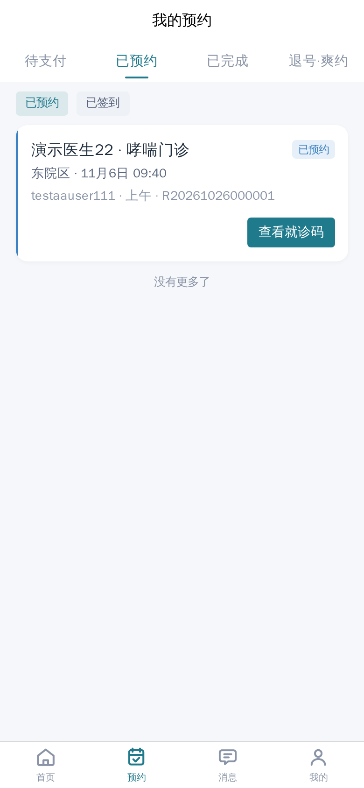
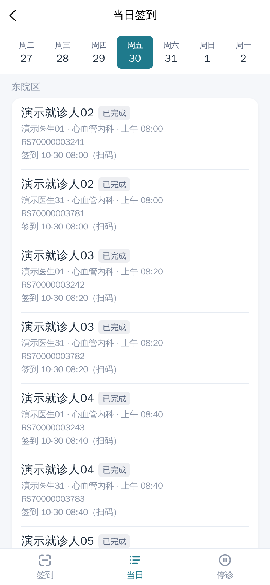
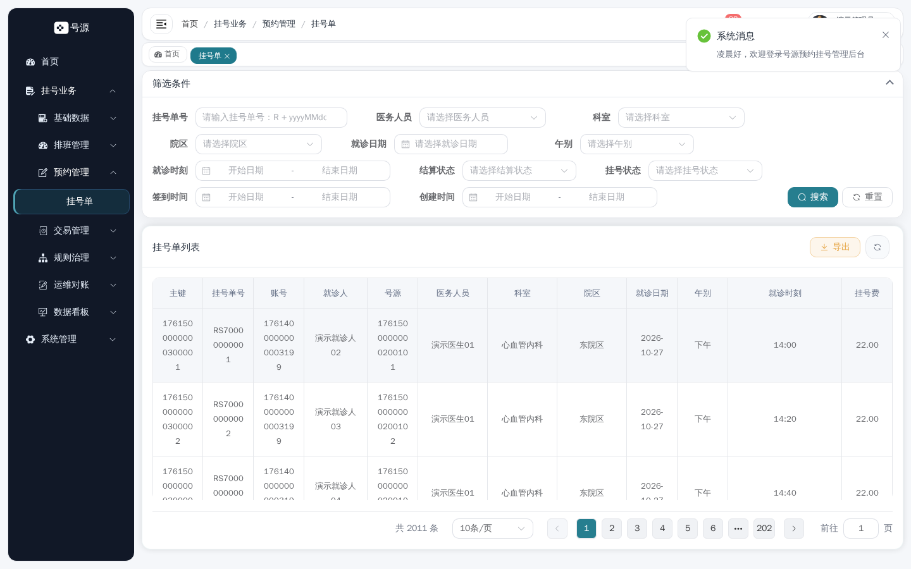
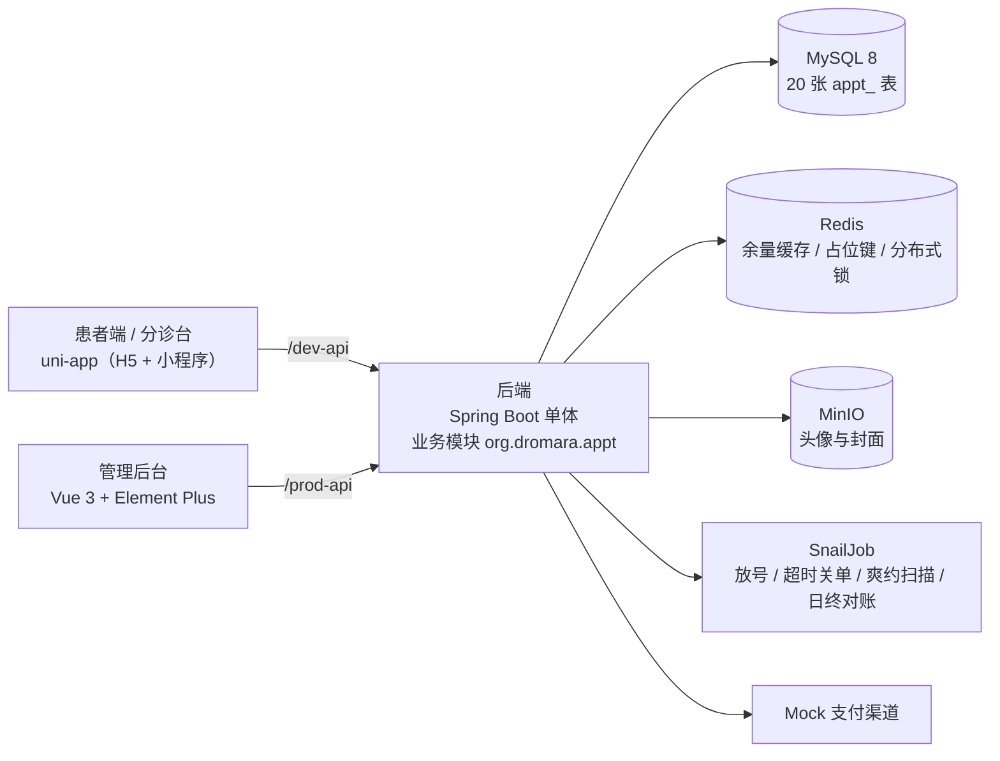

# 号源 QueueDepth · 医院门诊预约挂号系统

> 面向医院门诊的预约挂号系统：患者在移动端完成「选院区 → 科室 → 医生 → 号源 → 支付 → 就诊码」，分诊台扫码签到并上报停诊，管理端做排班放号、号源台账、七查对账与运营看板。
>
> **技术演示项目：数据全部虚构，不使用任何真实医院 / 科室 / 医务人员信息；支付走 Mock 渠道；不问诊、不开方，不提供任何真实医疗服务。**

## 项目地址与演示体验

- **在线演示（患者端 + 分诊台）：** <https://demo.qdappt.us.ci/>
- **管理后台：** <https://admin.qdappt.us.ci/>
- **后端仓库：** <https://github.com/xcqj/qd-appt-backend>
- **管理端仓库：** <https://github.com/xcqj/qd-appt-admin>
- **移动端仓库（患者端 + 分诊台）：** <https://github.com/xcqj/qd-appt-app>
- **文档仓库：** <https://github.com/xcqj/qd-appt-docs>

> **演示环境说明：** 当前演示环境通过 Cloudflare Tunnel 转发至本地 WSL2 上的 Docker Compose 栈，依赖本机与隧道持续运行，因此并非全天候在线（2026-11-13 实测两个入口均为 502）。若需体验完整系统，请在招聘平台与我约定时间，我会提前启动演示环境，并通过私下渠道提供对应角色的临时体验账号。体验账号只用于查看虚构演示数据，管理员同样使用权限受限的临时账号；本仓库与各业务仓均不出现任何账号口令。

本地一键起（不依赖在线演示）：

```bash
mkdir -p qd-appt && cd qd-appt
for r in backend admin app docs showcase; do git clone git@github.com:xcqj/qd-appt-$r.git; done
cd showcase && ./demo.sh     # 前置：只装 Docker（含 compose ≥ 2.20）
```

就绪后的本地入口：患者端 `http://localhost:18084` ｜ 管理后台 `http://localhost:18083` ｜ OpenAPI JSON `http://localhost:18082/v3/api-docs` ｜ 调度控制台 `http://localhost:18800/snail-job`。

## 项目功能

| 角色 | 主要功能 |
|---|---|
| 患者（H5 / 小程序） | 选院区 → 科室 → 医生 → 排班与余量 → 时间点 → 确认 → 支付 → 就诊码；我的预约、退号、就诊人管理、收藏医生、站内信 |
| 分诊台（同一 App 的角色视图） | 就诊码签到 / 手动补签、当日签到列表、停诊上报（按排班 / 医生某日 / 院区某日） |
| 医院运营（管理后台） | 院区 / 科室 / 医务人员 / 时段模板 / 收费标准维护、排班生成与放号、挂号单与支付单、停诊处理、黑名单与限购、号源台账、七查对账、运营看板 |

范围：单医院 3 个院区；普通 / 夜间延时 / 知名专家三类门诊；挂号及其支付、签到履约、退号退款与停诊售后。
明确不做：医保、真实支付渠道签约、候补队列、改约、在线问诊与开方、检查治疗预约、报告 / 账单 / 评价、多医院租户化、全文检索。

## 界面预览

**患者端 · 我的预约** —— 已预约 / 已签到子筛选、就诊码入口与预约卡片。



**患者端 · 消息中心** —— 站内信列表，含退号与爽约提醒（爽约累计触及限购阈值前会提示）。


**分诊台 · 签到** —— 当前账号为分诊角色；H5 无扫码能力时按就诊码手动补签，并提示签到窗口规则。


**分诊台 · 当日签到** —— 按就诊日与院区查看当日签到记录，含就诊人、医生、科室与签到时间。



**管理后台 · 挂号单** —— 多条件筛选与挂号单列表，覆盖号源、就诊人、医务人员、院区、就诊日与挂号费。



## 系统架构



- **模块化单体**：一个后端进程、一个库，业务集中在 `org.dromara.appt` 内按领域分包；不使用微服务、MQ、ES，搜索用 `LIKE`。
- **四层 API 边界互不复用、服务端强校验**：`/appt/public/**` 匿名查询 · `/appt/patient/**` 登录患者 · `/appt/triage/**` 登录 + 分诊角色 · `/appt/admin/**` 登录 + 按钮权限。

## 技术栈

| 层次 | 选型 |
|---|---|
| 后端 | Java 21 · Spring Boot 4.1.0 · MyBatis-Plus 3.5.17 · Sa-Token 1.45.0 · Redisson 4.6.1 · SpringDoc 3.0.3 |
| 数据与中间件 | MySQL 8（`utf8mb4`）· Redis（余量缓存 / 占位键 / 分布式锁）· MinIO（对象存储） |
| 任务调度 | SnailJob 2.0.2（放号、超时关单、爽约扫描、置完成、日终对账，执行结果落 `appt_job_log`） |
| 管理后台 | Vue 3.5 · TypeScript 6 · Element Plus 2.14 · Vite 8 · pnpm |
| 移动端 | uni-app 3.0（Vue 3 + TS）· Wot UI 2.3 · 一套代码出 H5 与微信小程序 |
| 工程与部署 | Maven 多模块 · GitHub Actions · GHCR 镜像 · Docker Compose（五件套）· 自托管 Runner |

## 核心技术实现

**1. 号源并发：三道防线各管一段**
- 问题：同一时间点只有一个号源，并发下单必须恰好一单成交；缓存不可用时也不能超卖。
- 方案：① `SET NX` 写占位键（TTL = 支付时限，可配置关闭）挡在数据库之前；② `UPDATE slot SET status='TAKEN' WHERE id=? AND status='AVAILABLE'` 单柱 CAS，影响行数 0 即失败；③ `UNIQUE(slot_id, active_flag)` 兜住「同一号源只能有一张有效单」。占位释放用 Lua 比对 value 后删除，避免误删他人键。
- 验证：50 并发争抢同一号源，成功 1 笔、`SLOT_GONE` 49 笔；摘掉防线① 的对照实验仍 1 笔成交、49 笔被数据库 CAS 拒绝（`test-evidence.md` §2/§3）。
- 边界：50 并发是本机单机脚本规模，不能外推为任意并发度下的证明；结论是「三层各有职责、任一层失效仍有下一层」，不宣称任何并发下都不超卖。

**2. 限购：先串行化账号，再在锁内精查**
- 问题：黄牛用同一就诊人批量占号；简单的「先查后插」在并发下会被穿透。
- 方案：口径为同一就诊人同一就诊日 1 单、跨院区共享额度；下单前对账号行 `SELECT ... FOR UPDATE` 串行化同一账号，锁内按规则精查并返回精确错误码（如 `LIMIT_PATIENT_DAY`），最后仍由唯一索引兜底；黑名单判定必须复用同一把账号锁。
- 验证：同日跨科室下单被拦下、不同就诊日各下 1 单成功；同一幂等键双击第二次返回 `duplicate=true`、库中仅 1 单（`test-evidence.md` §2）。
- 边界：只解决同一账号的并发，跨账号争抢同一号源由第 1 项负责；行锁会放大同账号请求排队，属预期代价。

**3. 停诊：两段式 + 一条登记一个批号**
- 问题：停诊直接退号退款，误操作与重复提交会放大影响面，且不可逆。
- 方案：登记只落 `PENDING` 记录，不动号源、不退款、不发通知；处理时才回池、把已预约单转 `CANCELED_PASSIVE`、对已支付单建退款单并发站内信；一条登记一个批号，按批号 + 状态 CAS，重复处理返回 `handled=false`；已签到单跳过不参与批量退号。
- 验证：`PASS=25`，摘要为「排班 1 / 号源 2 / 被动退号 1 / 退款 1 / 跳过已签到 1」；同范围重复登记返回同批号且不新建行，重复处理退款单仍 1 条（`test-evidence.md` §9）。
- 边界：批量不可逆，只有后台按钮层的一次确认；已签到单视为已履约需人工处理；真实渠道退款未验证（Mock 渠道）。

**4. 余量查询：一次聚合 + 有守卫的缓存增量**
- 问题：排班页要显示「每位医生 × 每个午别」的可约余量，直觉写法是每位医生两次 `COUNT`，一屏查询次数随医生数线性增长。
- 方案：读取走一条 `GROUP BY schedule_id, period` 聚合（单屏固定 2～3 条 SQL，与医生数无关），未命中回填 `appt:remain:<scheduleId>:<period>`（TTL 600s）；写路径唯一入口在事务 `afterCommit` 经 Lua `EXISTS → INCRBY ±1`，键不存在就不创建；增量按目标状态分支（可约→已占 −1、已占→可约 +1、已占→已过期 0）。
- 验证：100 并发 × 1000 样本 × 3 轮，缓存 p95 9.3 ms、直查 p95 10.6 ms（curl 开销计入）；串行 1000 次「挂号 → 超时关单」后逐键比对，缓存与数据库差值 0（`test-evidence.md` §7）。
- 边界：延迟差异只有 14%，结论是「默认保持缓存」而非「缓存显著更快」；一致性检查是串行循环，不是并发一致性验证。

**5. 支付回调：先落库去重，再异步入账**
- 问题：渠道会重复、乱序回调，甚至在订单关闭后才回调；直接「回调即改单」会重复入账或状态回退。
- 方案：验签 → 回调 append-only 落库（带去重键）→ 立即 ack → 异步入账（有界线程池 + 独立事务）；重复回调命中唯一键标记 `duplicate=true`；关单后到达的回调自动转退款分支，不回退挂号单状态；超时关单巡检三步 CAS + `RELEASE` 台账 + 释放占位。
- 验证：同一支付单回调重复 3 次，入账 1 次、回调记录 1 条、2 次标记重复（`test-evidence.md` §5，脚本 `PASS=20`）；并发 5 次关单仅 1 次生效；篡改签名的回调被拒绝。
- 边界：全部基于 Mock 渠道，真实渠道的签名算法、证书轮换与对账文件未验证；异步入账为秒级最终一致，不提供同步入账保证。

## 测试与验证

以下全部为**本机单机环境**的实测记录，复现脚本在 `qd-appt-backend/script/test/`，原始输出在 `qd-appt-docs` 仓的 `test-evidence.md`。

| 验证项 | 方式 | 规模 / 条件 | 结果 | 出处 |
|---|---|---|---|---|
| 排班生成幂等 | 单机脚本 + 调度控制台 | 80 排班 / 2820 号源 | 连跑两次：新增 0、跳过 2820 | §1 |
| 并发抢同一号源 | 单机脚本 | 50 线程争 1 个号源 | 恰 1 笔成交、49 笔 `SLOT_GONE`；`PASS=14` | §2 |
| 摘除 Redis 占位的对照 | 启动参数 A/B | 同上 | 仍 1 成交、49 被数据库 CAS 拒绝，占位键不存在 | §3 |
| 支付回调幂等 | 单机脚本 | 同一回调重复 3 次 | 入账 1 次、回调记录 1 条、2 次标记重复；`PASS=20` | §5 |
| 余量缓存读取 | 单机压测（curl 开销计入） | 100 并发 × 1000 样本 × 3 轮 | p95：缓存 9.3 ms / 直查 10.6 ms；QPS 1050 / 1160 | §7 |
| 状态机闭环 | 单机脚本 | 退号 / 退款 / 签到 / 爽约 | `PASS=19`；爽约全量兜底可判出陈旧单 | §8 |
| 终态号源释放 + 对账 | 夹具 + 手工触发 | 七查 | 对账 907 ms、七查全 0、结果 0 行 | §23 |
| 发布 / 回滚 | 手工实跑 + CI | 四枚镜像 | 发布 39 s、回滚 42 s、前滚 46 s、备份 1 s、恢复 62 s | §25 |

口径与限制：以上是**单机脚本 / 配置开关对照 / 手工验收**，不是生产压测，也不能外推为线上容量结论；并发用例规模为 50（下单）与 100（读取），未做千级并发与长稳测试；缓存对比的 14% 差异在单机噪声范围内；对账与发布耗时与机器规格、镜像缓存强相关；未做故障注入（Redis 宕机、主从切换、网络分区），只实测了「关掉缓存占位」一种降级路径。

## 项目说明与当前边界

- **项目性质**：个人作品与技术演示，业务规则、库表设计与接口契约在 `qd-appt-docs` 仓（PRD / 技术方案 / api-contract / database-design）；全部数据虚构，支付为 Mock 渠道，不产生真实资金流，也不提供任何真实医疗服务。
- **部署形态**：演示走本地 WSL2 + Docker Compose + Cloudflare Named Tunnel，按需开启、可能因宿主机休眠或网络中断不可用；云服务器与公网 HTTPS（S16.2）**未开始**，阻塞于服务器未就绪，`cloud` 目标只保留结构，无公网验收记录。
- **小程序**：一套代码同时出 H5 与小程序，但小程序合法域名与真机扫码在公网部署前无法验收，演示以 H5 为主，小程序界面未做自动化截图。
- **已知工程边界**：没有版本化数据库迁移工具（DDL 采用「先加后删」两阶段纪律）；演示态与开发态端口分离（`18xxx` / `8xxx`）但共用同一台机器；镜像 tag 需跨仓一致；备份为手工触发而非定时任务；不提供 Swagger UI，只有四组 OpenAPI JSON。
- **进度**：当前 `v0.7.11`（2026-10-30），切片 S1–S16.1 已完成。
- **凭据**：本仓只含文档与脚本产出的截图，不含任何凭据、账号口令或环境文件；公开前审计的范围、风险分级与未检查项见 [SECURITY_REVIEW.md](SECURITY_REVIEW.md)。
