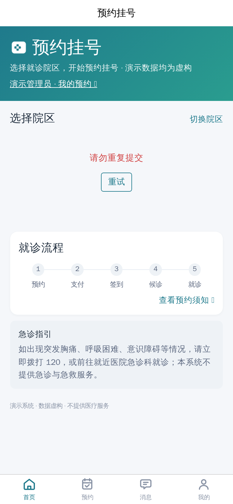
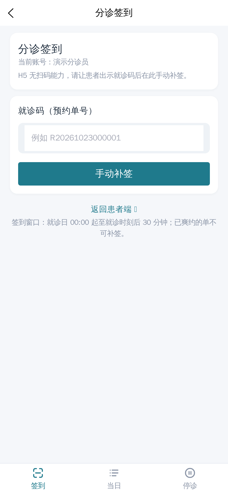
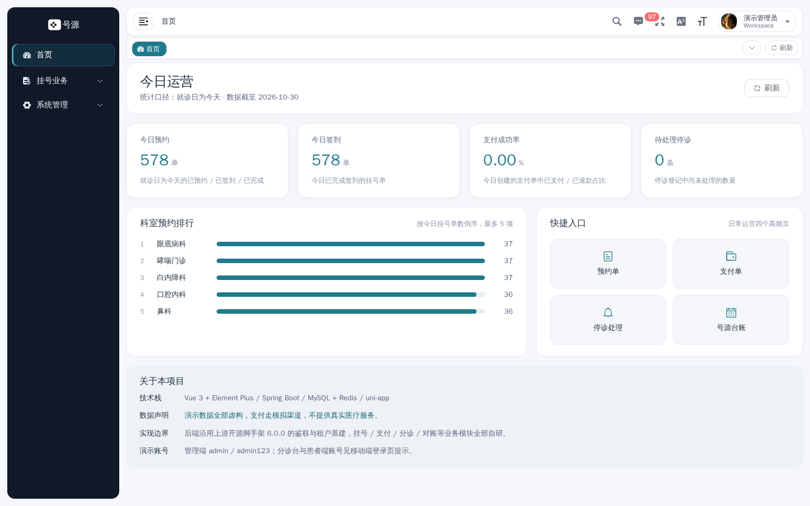
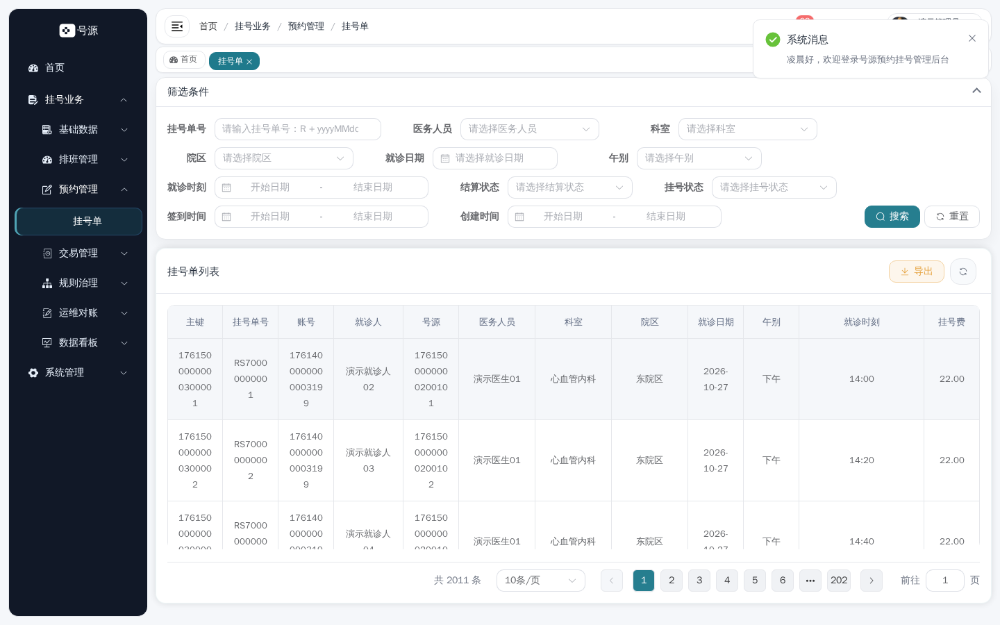

# 演示指南

> 5 分钟能走完主链路，30 分钟能自己起一套。
> 数据全部虚构，支付为 Mock 渠道，**不提供任何真实医疗服务**。

---

## 1. 两种进入方式

### 1.1 在线演示（按需开启）

| 应用端 | 地址 | 说明 |
|---|---|---|
| 患者端 H5 | <https://demo.qdappt.us.ci/> | 手机或桌面浏览器打开 |
| 分诊台 | <https://demo.qdappt.us.ci/> | **与患者端同一入口**，按登录账号的角色进入不同底栏 |
| 管理后台 | <https://admin.qdappt.us.ci/> | 桌面浏览器打开 |

- 演示环境跑在**本机 WSL2 + Docker Compose + Cloudflare Named Tunnel** 上，**按需开启**：宿主机休眠、关机、网络或维护期间不可访问，不承诺 SLA。
- 2026-11-11 实测两个域名均不可用（隧道的后端未启动），属于正常状态；需要体验时联系维护者开启。
- **账号不公开**：账号由维护者私下按角色提供，权限最小化；管理员账号不对外分发。请勿在演示环境写入任何真实个人信息。

### 1.2 本地一键起（推荐自己跑）

```bash
# 前置：Docker（含 compose ≥ 2.20）；五个仓同级 clone 到同一目录
git clone git@github.com:xcqj/qd-appt-backend.git
git clone git@github.com:xcqj/qd-appt-admin.git
git clone git@github.com:xcqj/qd-appt-app.git
git clone git@github.com:xcqj/qd-appt-docs.git
git clone git@github.com:xcqj/qd-appt-showcase.git
cd qd-appt-showcase && ./demo.sh
```

就绪后：

| 入口 | 地址 |
|---|---|
| 患者端 / 分诊台 | `http://localhost:18084` |
| 管理后台 | `http://localhost:18083` |
| 后端 OpenAPI JSON | `http://localhost:18082/v3/api-docs`（四组，见下） |
| 任务调度控制台 | `http://localhost:18800/snail-job` |

常用子命令：`./demo.sh down`（停止保留数据）/ `reset`（清数据卷）/ `logs`。首次约 2–8 分钟，复跑约 1 分钟。

> **端口别记错**：演示态固定 `18xxx`，开发态（`pnpm dev`）是 `8xxx`。两者可以同时存在，敲错就会打开热更新的开发服务器而不是演示栈。

**OpenAPI 分组**：`1.门诊预约业务` / `2.系统与权限` / `3.通用能力` / `4.代码生成`。本项目未引入 Swagger UI，`/doc.html` 不存在；用 Apifox / Insomnia / Postman 导入 JSON 浏览。

---

## 2. 三类角色怎么体验

### 2.1 患者端（约 2 分钟）

| 步骤 | 做什么 | 应该看到 |
|---|---|---|
| 1 | 未登录直接点「预约」 | 页内提示「未登录，无法查看预约」并提供登录入口，底部导航仍在 |
| 2 | 登录 | 登录后**退回原来的 tab**，不整屏跳走；登录有图形验证码 |
| 3 | 首页 → 选院区 | 当前院区只有一张卡带「当前」标签，其余卡片不带 |
| 4 | 科室 → 医生列表 → 医生主页 | 医生主页只出现「满诊 / 无号」两个词（不会出现「有排班 / 无排班」） |
| 5 | 「查看排班」→ 选日期 → 选时间点 | 无号的格子显示「无号」；余量随号源变化 |
| 6 | 确认预约 → 支付（模拟渠道） | 支付成功后落到「我的预约」，状态变「已预约」 |
| 7 | 打开该单 | 就诊码卡（单号 + 二维码占位）+ 就诊人 / 证件类型 / 证件号三行 |

**限购说明（演示时最容易被问）**：同一就诊人**同一就诊日只能 1 单**，跨院区共享额度。要连演示两次，先在第 7 步「退号」，额度立即释放。

### 2.2 分诊台（约 1.5 分钟）

| 步骤 | 做什么 | 应该看到 |
|---|---|---|
| 1 | 用分诊角色登录同一 H5 | 直接进入「分诊签到」，底栏三项（签到 / 当日 / 停诊） |
| 2 | 「扫一扫」或「手动补签」输入预约单号 | 签到成功，状态变「已签到」，同时写一条站内信 |
| 3 | 「当日」列表 | 今日已预约 / 已签到一览 |
| 4 | 「停诊」→ 登记（按排班 / 医生某日 / 院区某日） | 只落「待处理」，**不动号源**；同一范围重复登记返回原批号 |

扫码需要真机 + 局域网，桌面演示用「手动补签」更稳。

### 2.3 管理后台（约 1.5 分钟）

| 步骤 | 做什么 | 应该看到 |
|---|---|---|
| 1 | 登录 | 青白两栏登录页 + 今日运营看板（今日预约 / 签到 / 支付成功率 / 待处理停诊） |
| 2 | 侧栏「挂号业务」 | 只有业务菜单（预约管理 / 交易管理 / 规则治理 / 运维对账…），无框架示例菜单 |
| 3 | 预约管理 → 挂号单 | 状态是彩色标签（待支付 / 已预约 / 已签到 / 已爽约…） |
| 4 | 挂号业务 → 停诊登记 | 分诊刚登记的记录是「待处理」；处理后可见号源回池与退款 |
| 5 | 运维对账 → 对账结果 | 七查结果；修复后再跑应归零 |

### 2.4 推荐讲解顺序

一句话开场（10 秒）→ 患者在 H5 下单支付（2 分钟）→ 切分诊账号签到 + 登记停诊（1.5 分钟）→ 后台处理停诊 + 看对账（1.5 分钟）。
讲解点：**号源为什么不会被两个人抢到**、**停诊为什么要两段式**、**余量为什么能一屏一次查完**。

---

## 3. 界面预览

| 患者端首页 | 分诊签到 | 管理看板 | 挂号单 |
|---|---|---|---|
|  |  |  |  |

截图由 `qd-appt-showcase` 仓的 Playwright 脚本产出（固定视口、无 `sleep`、重跑覆盖），非手工截取。

---

## 4. 常见卡点

| 现象 | 原因 / 处理 |
|---|---|
| 提示「同日已有一单」 | 触发限购；先在「我的预约」退号释放额度 |
| 登录页没有验证码 | 后端不是演示配置启动的（演示/截图环境才放开验证码） |
| 打开页面却是旧版本 | 端口敲错，进到了开发态 `8xxx` 而不是演示态 `18xxx` |
| 号源全空 | 当天没有排班：换日期，或在后台跑一次排班生成 |
| 停诊处理报「已处理」 | 幂等生效；换一条登记，或看该登记是否已是「已处理」 |
| 对账有差异 | 先看「支付回调」是否有重复；大部分差异可被下一轮对账自动修复 |
| 小程序扫码不可用 | 小程序需要 HTTPS + 域名白名单，公网部署（S16.2）未开始；演示以 H5 为主 |

---

## 5. 演示环境的边界

- 演示数据会被任何访问者修改（下单、退号、停诊），属预期；重要演示前建议自己跑一遍主链路确认数据状态。
- 演示栈是**单机演示形态**：没有高可用、没有自动扩缩、没有定时备份（备份为手工触发）。
- 演示环境的账号与口令不写进任何公开文档；需要体验请通过私下渠道获取。
- 线上演示依赖本机与隧道，**不可用是常态之一**，本地 `./demo.sh` 是稳定路径。
